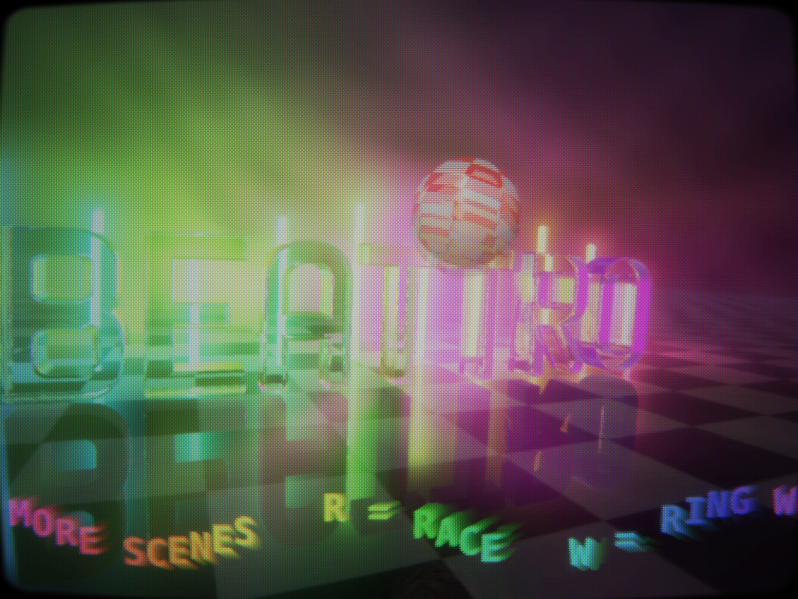
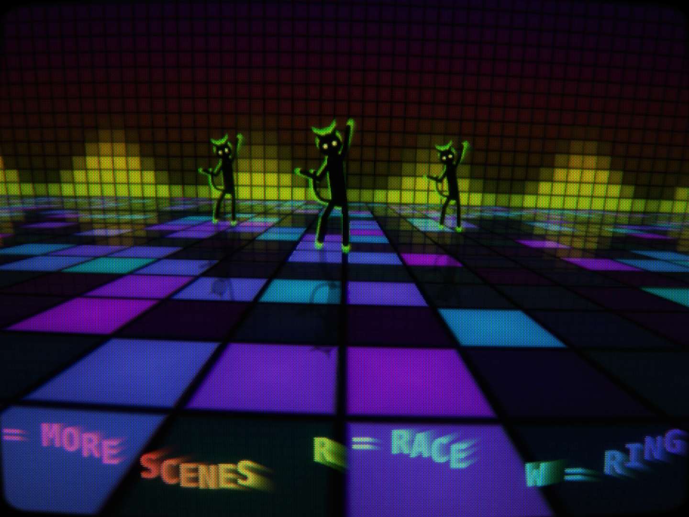
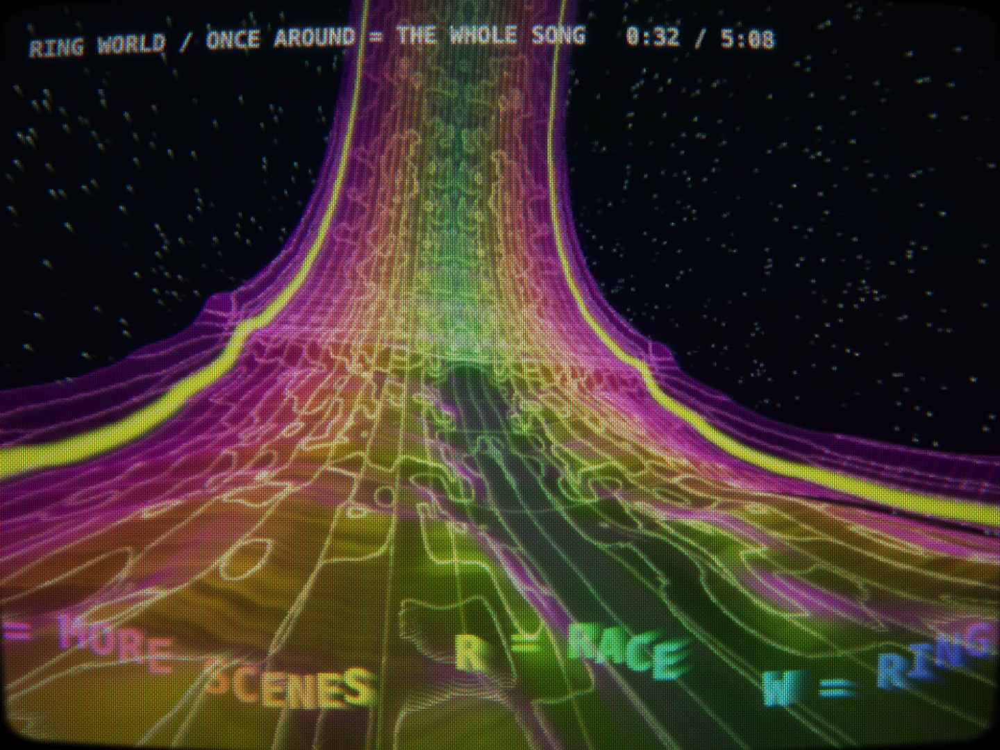

# BEATTRO

A music visualiser in one HTML file, in the style of the demoscene of the late
eighties and early nineties. Drop a song on the page and it plays it with
41 scenes that follow the beat: tunnels, copper bars, fractals, a race, a ring
world built from the song itself, a dance floor, an endless zoom through the
suits of a deck of cards, a flight out of the solar system to a black hole
and more.

No server, no install, no assets: everything is code in `index.html`
(about 306 KB).



| | |
|---|---|
|  |  |

The title, the dance floor and the ring world in one of the retro tube looks
(`K`): hold-and-modify colours at 768 x 576, interlaced, on a simulated tube.

## Try it

1. Download `index.html` and open it in a browser.
2. Drop one or more audio or video files on the page, or press `O` to pick
   them. Several files play one after the other, in the order of their names.
   `BeautifulSorrowMaster.m4a` in this repository is there to try it with.
3. Click or press `Space`.

The song is analysed once on load (tempo, bar grid, kick pattern, where it
builds up and where the beat drops out). Scene changes, transitions and
pulses then sit on the beat instead of chasing it.

## What it does

- **Moods**, chosen from the tempo: party, dark (slow songs and songs without
  a kick drum), disco (100 to 115 BPM, with a mirror ball) and techno
  (130 BPM and up, with fog, strobe lamps and lasers). `M` overrides.
- **Looks**, changing with the scenes or fixed with `K`: normal, solid, neon,
  psychedelic, HDR, code rain, and three retro tube looks: a 4:3 picture in
  hold-and-modify colours with their colour fringes, afterglow, scan lines,
  a phosphor mask and curved glass, one of them at 384 x 288 and two
  interlaced.
- **Changing the channel**: a scene change can come as a zap on an old
  television (a burst of snow, the new picture rolls into place, colour
  arrives last) or as slow tuning from one station to the next (the sound
  gets into the picture as bars and a fine pattern, the colour drops out,
  snow, and the new scene comes in soft and grey until the set locks on to
  it). In the tube looks that is the usual way to change, in the other
  looks it happens now and then, on the plain picture.
- **The grand tour**: a flight from an orbit round the Earth past the Moon,
  through the asteroid belt, past Jupiter, down through Saturn's rings and
  past two comets to a space probe on its way out, then faster than light
  to a black hole and into it, with the sun rising over the Earth's rim,
  eclipses, lens flares and a fog through which planets, moons and rocks
  cast their shadows. As one
  scene among the others every visit shows the next of its five legs; with
  `E` it is held and the song is the flight, Earth as it starts, the black
  hole as it ends.
- **Title and artist** from the file's tags (ID3v2 in an MP3, the iTunes
  tags in an MP4 or M4A): the scroller opens with them when the song starts
  and brings them again on every round; the dark mood, which has no
  scroller, shows them now and then as a line in the lower bar.
- **Real HDR** in Chromium-based browsers on a screen in HDR mode: highlights
  go brighter than white.
- **Steady 60 frames a second**: the resolution adapts, up to 4K.

## Keys

| Key | |
|---|---|
| `Space` | play / pause |
| `O` | open files |
| `F` | fullscreen |
| `Up` `Down` | volume |
| `N` | next scene (random) |
| `Left` `Right` | previous / next scene in order |
| `Shift` + `Left` `Right` | previous / next song of the list (also the media keys) |
| `1`-`9`, `0` | scenes 1 to 10, with `Shift` 11 to 20 |
| `R` `W` `G` `D` `T` `B` `J` `S` `U` `C` | race, ring world, glow forest, dance, title, light bikes, jump and run, attack run, the dive, dance floor |
| `E` | the grand tour, held for the whole song (`L`, `N` or another scene ends that) |
| `L` | hold the scene |
| `M` | mood: auto, party, dark, disco, techno |
| `K` | look |
| `Q` | resolution: steady 60 fps or fixed |
| `P` | glow and lens effects on / off |
| `I` | frame rate display |
| `,` `.` | picture earlier / later (sync), in steps of 10 ms |
| `X` `V` | tube looks: brightness (real HDR only), strength of the phosphor strips (with `Shift`: less); back to normal on reload |
| `H` | this list, with the current settings |

## Flashing lights

This is a music visualiser: it pulses and flashes with the beat. The strobes
of the techno mood are limited to three flashes a second and are off when the
system asks for reduced motion, the interlaced looks cap how far a line
may dim between frames, and the snow of a channel zap counts as one of those
three flashes (zap and tuning are left out under reduced motion). That is care taken, not a guarantee: if you are
sensitive to flashing light, be careful.

## Requirements

A browser with WebGL2. Without it a smaller set of scenes runs on a plain
canvas. Real HDR needs a Chromium-based browser (Chrome or Edge 129 or later,
Vivaldi) and an HDR screen; Safari shows the same picture without it.
Tested in Safari and Chrome on macOS; Firefox is untested.

## Development

The page is built from the files in `src/`:

```
node build.mjs    # pours src/ into index.html
node test.mjs     # builds, then checks syntax, beat and tempo detection, song sections, the tag reader, the flash limits, the channel-change envelopes
```

Edit only in `src/`; `index.html` is generated. Node is the only thing needed
for building and testing, there are no dependencies.

`tools/` holds what was used to look at the result without a screen:
`dbg.py` (stills and flicker figures from a software renderer), `gpu.py`
(frame rate and GL errors on the real graphics card) and `sync.mjs` (bar grid
against kick onsets). The two Python tools expect Playwright's Chromium on
macOS.
